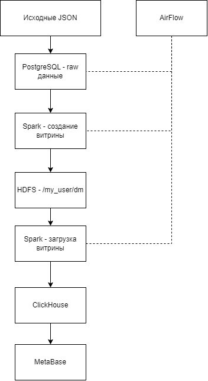

# CityBikes

Финальный проект по загрузке, преобразованию и визуализации данных из набора CityBikes.

## Стек технологий

Python, Airflow, Docker, SQL, PostgreSQL, Spark, Hadoop HDFS, ClickHouse, Metabase, Git

Обзор DAG
`citybikes_raw` - Загружает JSON в таблицы сетей и станций в PostgreSQL. При повторном запуске обновляет записи по ключам
`citybikes_obt` - Запускает Spark обьединяет сети и станции по идентификатору сети. Записывает Parquet в `hdfs://namenode:9000/my_user/dm`
`citybikes_clickhouse` - Запускает Spark для чтения Parquet. Загрузчик сверяет число строк и заменяет витрину в ClickHouse без повторного добавления тех же данных



## Файлы проекта

* `compose.yaml` - Запуск сервисов и подключение каталогов проекта
* `dags/` - Три основных DAG и `check_citybikes` для проверки подключения
* `sql/init/create-databases.sql` - Инициализация баз PostgreSQL и базы сырых данных
* `sql/citybikes_raw.sql` и `src/citybikes_raw.py` - Схема RAW и загрузка сетей и станций
* `spark_jobs/prepare_spark_obt.py` - Преобразование данных и формирование One Big Table
* `spark_jobs/create_spark_session_obt.py` Чтение PostgreSQL через JDBC и сохранение Parquet в HDFS
* `spark_jobs/load_citybikes_clickhouse.py` - Чтение Parquet и загрузка в ClickHouse
* `spark_jobs/spark_server.py` Запуск Spark-задач по запросам из Airflow
* `docker/spark/Dockerfile` - Сборка образа Spark с `clickhouse-connect==0.8.18` из локальных пакетов

## Запуск

Команды выполняются из корня проекта на Linux с Docker Compose

### 1. Подготовка данных

Список сетей в `data/networks.json`, файлы станций `stations_*.json` - в `data/stations_output/`.
При запуске в первый раз создать локальный `.env`  с переменной переменную `AIRFLOW_UID` со значением: `id -u` 

Скачать JDBC-драйвер PostgreSQL и пакеты Python для образа Spark

```bash
mkdir -p spark_jobs/jars docker/spark/wheels
curl -fL --retry 3 -o spark_jobs/jars/postgresql-42.7.14.jar \
  https://repo.maven.apache.org/maven2/org/postgresql/postgresql/42.7.14/postgresql-42.7.14.jar

sudo docker run --rm --user "$(id -u):$(id -g)" --entrypoint python3 \
  -v "$PWD/docker/spark/wheels:/wheels" \
  apache/spark:3.5.5-scala2.12-java11-python3-ubuntu \
  -m pip download --dest /wheels --find-links /wheels \
  --no-cache-dir --only-binary=:all: --timeout 60 --retries 5 \
  clickhouse-connect==0.8.18
```

### 2. Запуск сервисов

Первое подготовка PostgreSQL

```bash
sudo docker compose up -d --wait postgres
```

Если базы `metabase` и роли `metabase` ещё нет:

```bash
sudo docker compose exec -T postgres psql -U postgres -d postgres \
  -v ON_ERROR_STOP=1 -c 'CREATE USER metabase;'
sudo docker compose exec -T postgres psql -U postgres -d postgres \
  -v ON_ERROR_STOP=1 -c 'CREATE DATABASE metabase OWNER metabase;'
```

Сборка Spark и запуск проекта

```bash
sudo docker compose build spark
sudo docker compose up -d --wait
```

### 3. Настройка Airflow

Адресу `http://<IP>:8080`

Для `citybikes_raw` нужно подключение PostgreSQL с идентификатором `citybikes_pg`

Запуск дагов в РУЧНОМ режиме `citybikes_raw` -> `citybikes_obt` -> `citybikes_clickhouse`. Каждый следующий запускать после успешного завершения предыдущего

### 4. Подключение Metabase
`http://<IP>:3000`. При первом входе добавить источник данных ClickHouse

## Дашборд CityBikes

Число велосетей - Число уникальных идентификаторов сети
Доля сетей без информации о станциях- Доля сетей для которых в данных нет строк с заполненным названием станции
Топ-10 велосетей по числу станций - Рейтинг сетей по числу строк с заполненным названием станции
Топ-10 городов по доступным велосипедам - Доступные велосипеды и свободные места по городу велосети

**Количество велосетей**

```sql
select uniqExact(network_id) as networks
from citybikes.citybikes_obt
```

**Доля сетей без данных о станциях**

```sql
select round(100.0 * countIf(stations = 0) / nullIf(count(), 0), 1) as networks_without_stations_pct
from (
    select network_id, countIf(notEmpty(ifNull(station_name, ''))) as stations
    from citybikes.citybikes_obt
    where network_id is not null
    group by network_id
) as networks
```

**Топ-10 велосетей по числу станций**

```sql
select network_id, count() as stations
from citybikes.citybikes_obt
where network_id is not null
  and notEmpty(ifNull(station_name, ''))
group by network_id
order by stations desc, network_id
limit 10
```

**Топ-10 городов по доступным велосипедам**

```sql
select concat(network_city, ' (', ifNull(network_country, '—'), ')') as city, sumOrNull(station_free_bikes) as available_bikes, sumOrNull(station_empty_slots) as free_slots
from citybikes.citybikes_obt
where notEmpty(ifNull(network_city, ''))
  and notEmpty(ifNull(station_name, ''))
group by network_city, network_country
having available_bikes is not null
order by available_bikes desc, city
limit 10
```

## Проверка

```bash
sudo docker compose exec namenode hdfs dfs -ls /my_user/dm
sudo docker compose exec -T clickhouse clickhouse-client --user citybikes \
  --query 'SELECT count() AS rows_in_mart, uniqExact(network_id) AS networks FROM citybikes.citybikes_obt'
```
